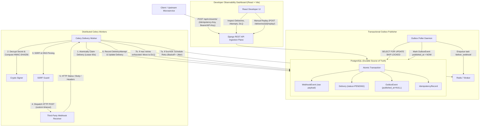

# HookSentry — Distributed Webhook Delivery Engine

[](https://www.python.org/)
[](https://www.djangoproject.com/)
[](https://react.dev/)
[](https://docs.celeryq.dev/)
[](https://redis.io/)
[](https://www.postgresql.org/)
[](LICENSE)

**HookSentry** is an enterprise-grade webhook delivery infrastructure platform engineered to guarantee **at-least-once delivery semantics** for distributed microservice architectures.

Built with Python/Django, Celery, Redis, PostgreSQL, and React, HookSentry provides cryptographic HMAC-SHA256 request signing, transactional outbox publishing, exponential backoff with jitter, dead-letter recovery with manual replay, multi-tenant isolation, and a real-time developer observability dashboard.

---

## 1. Core Engineering Principles

1. **At-Least-Once Delivery Semantics**: Designed to survive broker failures, worker process crashes, temporary network drops, and downstream server outages. PostgreSQL is the durable source of truth.
2. **Transactional Outbox Pattern**: Ingestion APIs commit the `WebhookEvent`, `Delivery`, and `OutboxEvent` within a single ACID transaction. The asynchronous Outbox Publisher safely relays events to Celery/Redis without risking distributed transaction failure.
3. **Zero In-Transaction External I/O**: External HTTP requests are never made inside database transactions, preventing database connection pool exhaustion.
4. **Idempotency Everywhere**: Safe against duplicate event producer retries via SHA-256 payload hashing and `unique_together` constraints.
5. **Cryptographic Integrity & Replay Defense**: Request signatures computed using HMAC-SHA256 over `timestamp.payload` canonical strings. Endpoint signing secrets are encrypted at rest with Fernet and rotatable on demand.
6. **Defensive SSRF Mitigation**: Full socket-level IP resolution checks rejecting loopback addresses (`127.0.0.0/8`, `::1`), private networks (RFC 1918), cloud metadata endpoints (`169.254.169.254`), and DNS rebinding attacks.

---

## 2. System Architecture



---

## 3. Quick Start with Docker Compose

Start the full stack with a single command:

```bash
# 1. Clone repository
git clone https://github.com/example/hooksentry.git
cd hooksentry

# 2. Configure environment
cp .env.example .env

# 3. Launch platform
docker compose up --build
```

### Accessing the Platform:
- **Developer Observability Dashboard**: [http://localhost:5173](http://localhost:5173)
  - Default Credentials: `admin@hooksentry.dev` / `AdminPass123!`
- **Django REST API**: [http://localhost:8000/api/v1/](http://localhost:8000/api/v1/)
- **Swagger Interactive API Documentation**: [http://localhost:8000/api/docs/](http://localhost:8000/api/docs/)
- **Redoc Documentation**: [http://localhost:8000/api/redoc/](http://localhost:8000/api/redoc/)

---

## 4. Local Development Setup

### Backend & Workers
```bash
# Set up virtual environment
python -m venv .venv
source .venv/bin/activate  # On Windows: .venv\Scripts\activate

# Install dependencies
pip install -r backend/requirements.txt

# Run migrations & seed demonstration data
python backend/manage.py migrate
python backend/manage.py seed_data

# Run tests
pytest backend/tests

# Start API server
python backend/manage.py runserver 0.0.0.0:8000
```

### Frontend Dashboard
```bash
cd frontend
npm install
npm run dev
```

---

## 5. End-to-End Scenario Verification

HookSentry satisfies the complete production-grade delivery lifecycle:
1. **User Registration & Tenant Creation**: A new user registers and is automatically designated `OWNER` of a dedicated workspace.
2. **Endpoint Creation**: An endpoint is registered for `order.created` at `https://webhook.site/...`. A unique signing secret (`whsec_...`) is generated and encrypted at rest with Fernet.
3. **Event Ingestion**: Upstream client submits `order.created` with an idempotency key.
4. **Outbox Commitment**: `WebhookEvent`, `Delivery` (PENDING), and `OutboxEvent` are committed in the same database transaction.
5. **Transactional Publishing**: The outbox poller publishes the task to Redis and stamps `published_at`.
6. **Worker Claim & Lease**: Celery worker atomically claims the delivery with a 60-second processing lease.
7. **HMAC-SHA256 Signing**: Payload is signed:
   `X-HookSentry-Signature: sha256=<hash>`
   `X-HookSentry-Timestamp: <epoch>`
8. **HTTP Dispatch & Attempt Logging**: Worker dispatches the request and logs duration, response headers, and body in `DeliveryAttempt`.
9. **Automated Retries**: When downstream returns HTTP 503 or 429, retries are scheduled using exponential backoff with full jitter and `Retry-After` header extraction.
10. **Dead-Letter Queue & Manual Replay**: After 5 failed attempts, the delivery enters `DEAD_LETTERED`. The developer inspects the failure in the dashboard drawer and triggers a manual replay, which resets the state and executes attempt #6 while preserving the original event ID.
11. **Multi-Tenant Isolation**: Workspace A is completely isolated from Workspace B via scoped querysets and permission checks.

---

## 6. Complete Documentation Directory

Detailed technical documentation is available in the [`docs/`](docs/) directory:

- [01 — Project Overview](docs/01-project-overview.md)
- [02 — System Architecture](docs/02-system-architecture.md)
- [03 — Database Design & Schema](docs/03-database-design.md)
- [04 — Event Ingestion & Outbox](docs/04-event-ingestion.md)
- [05 — Celery & Redis Task Architecture](docs/05-celery-and-redis.md)
- [06 — Delivery Engine Execution](docs/06-delivery-engine.md)
- [07 — Cryptographic Request Signing](docs/07-hmac-signing.md)
- [08 — Retry Engineering & Dead-Letter Queue](docs/08-retry-and-dlq.md)
- [09 — Idempotency & Manual Replay](docs/09-idempotency-and-replay.md)
- [10 — Multi-Tenancy & RBAC](docs/10-multi-tenancy.md)
- [11 — Security & SSRF Protection](docs/11-security.md)
- [12 — REST API Reference](docs/12-api-reference.md)
- [13 — Frontend Architecture](docs/13-frontend-architecture.md)
- [14 — Automated Testing Strategy](docs/14-testing.md)
- [15 — Docker Deployment Guide](docs/15-docker-deployment.md)
- [16 — Local Development Guide](docs/16-development-guide.md)

---

## 7. License
This project is licensed under the MIT License.
