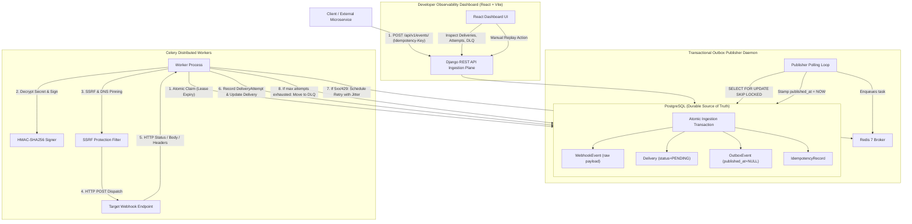
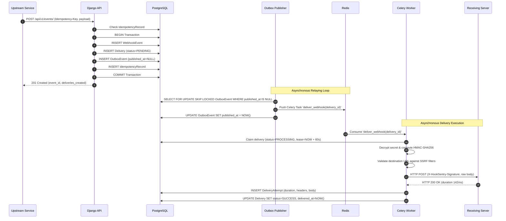

# 02 — System Architecture

## 1. Architectural Topology

HookSentry separates the ingestion plane, storage tier, background distribution engine, and presentation layer into distinct, decoupled subsystems.

---

## 2. Request Lifecycle Sequence

---

## 3. Core Guarantees & Constraints
- **At-Least-Once Delivery**: Messages are never lost when a worker crashes because the uncompleted delivery lease will expire, and the recovery heartbeat will re-enqueue it.
- **No In-Transaction External I/O**: External HTTP requests to destination endpoints are never executed inside database transactions, completely preventing database connection starvation.
- **Idempotent Ingestion**: Replays with identical idempotency keys return HTTP 200 with the previously generated event reference without duplicate delivery side effects.

