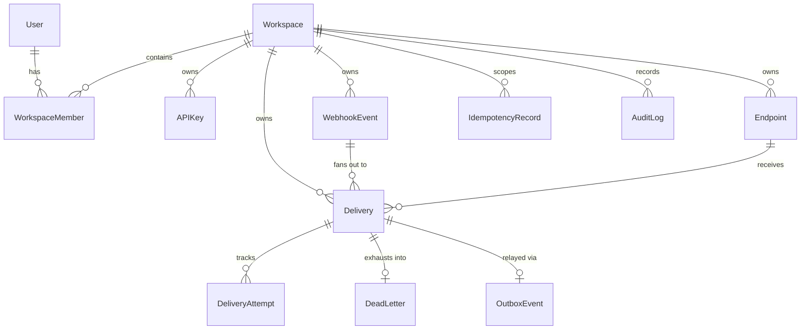

# 03 — Database Design

## 1. Relational Entity Relationship (ER) Model

---

## 2. Model Definitions & Constraints

### `User` (`hooksentry_users`)
Custom email-authenticated user model extending `AbstractBaseUser` and `PermissionsMixin`.
- `id` (UUID, PK)
- `email` (EmailField, Unique, Index)
- `full_name` (CharField)
- `is_active` (BooleanField, default=True)
- `is_staff` (BooleanField, default=False)
- `date_joined` (DateTimeField)

### `Workspace` (`hooksentry_workspaces`)
Tenant organization container.
- `id` (UUID, PK)
- `name` (CharField, max_length=255)
- `slug` (SlugField, Unique, Index)
- `created_at`, `updated_at` (DateTimeField)

### `WorkspaceMember` (`hooksentry_workspace_members`)
Associates users to workspaces with role-based permissions.
- `id` (UUID, PK)
- `workspace_id` (UUID, FK to Workspace, on_delete=CASCADE)
- `user_id` (UUID, FK to User, on_delete=CASCADE)
- `role` (CharField, choices=['OWNER', 'ADMIN', 'MEMBER'])
- `joined_at` (DateTimeField)
- **Constraint**: `unique_together = ('workspace', 'user')`

### `APIKey` (`hooksentry_api_keys`)
Machine-to-machine authentication credentials.
- `id` (UUID, PK)
- `workspace_id` (UUID, FK to Workspace)
- `name` (CharField)
- `prefix` (CharField, e.g. `hk_live_1234abcd`)
- `key_hash` (CharField 64, SHA-256 of raw key)
- `is_active` (BooleanField, default=True)
- `expires_at` (DateTimeField, nullable)
- `last_used_at` (DateTimeField, nullable)

### `Endpoint` (`hooksentry_endpoints`)
Destination webhook URL receiving event notifications.
- `id` (UUID, PK)
- `workspace_id` (UUID, FK to Workspace)
- `name` (CharField)
- `destination_url` (URLField, max_length=2048)
- `encrypted_signing_secret` (TextField, Fernet encrypted at rest)
- `event_types` (JSONField, list of strings e.g. `["order.*"]` or `["*"]`)
- `is_active` (BooleanField, default=True)

### `WebhookEvent` (`hooksentry_events`)
Original ingested event record. Immutable.
- `id` (UUID, PK)
- `workspace_id` (UUID, FK to Workspace)
- `event_type` (CharField, indexed)
- `payload` (JSONField, original JSON body)
- `idempotency_key` (CharField, nullable, indexed)
- `created_at` (DateTimeField, indexed)

### `Delivery` (`hooksentry_deliveries`)
Represents the delivery of one WebhookEvent to one Endpoint.
- `id` (UUID, PK)
- `workspace_id` (UUID, FK)
- `event_id` (UUID, FK to WebhookEvent)
- `endpoint_id` (UUID, FK to Endpoint)
- `status` (CharField, choices=['PENDING', 'PROCESSING', 'RETRY_SCHEDULED', 'SUCCESS', 'FAILED', 'DEAD_LETTERED'])
- `attempt_count` (PositiveIntegerField, default=0)
- `max_attempts` (PositiveIntegerField, default=5)
- `next_retry_at` (DateTimeField, nullable, indexed)
- `processing_started_at` (DateTimeField, nullable)
- `processing_lease_expires_at` (DateTimeField, nullable, indexed)
- `last_error` (TextField, blank=True)
- `last_response_status` (IntegerField, nullable)
- `delivered_at` (DateTimeField, nullable)
- **Constraint**: `unique_together = ('event', 'endpoint')`

### `DeliveryAttempt` (`hooksentry_delivery_attempts`)
Audit log for every HTTP execution attempt.
- `id` (UUID, PK)
- `delivery_id` (UUID, FK to Delivery)
- `attempt_number` (PositiveIntegerField)
- `request_headers` (JSONField, sanitized without raw secrets)
- `response_status` (IntegerField, nullable)
- `response_headers` (JSONField)
- `response_body` (TextField, truncated to 10KB)
- `duration_ms` (PositiveIntegerField)
- `error_message` (TextField, blank=True)
- `started_at`, `completed_at` (DateTimeField)
- `result` (CharField, choices=['SUCCESS', 'RETRYABLE_FAILURE', 'NON_RETRYABLE_FAILURE', 'TIMEOUT', 'SSRF_BLOCKED'])
- **Constraint**: `unique_together = ('delivery', 'attempt_number')`

### `DeadLetter` (`hooksentry_dead_letters`)
Tracks deliveries that have exhausted the retry policy.
- `id` (UUID, PK)
- `delivery_id` (UUID, OneToOneField to Delivery)
- `failure_reason` (TextField)
- `total_attempts` (PositiveIntegerField)
- `dead_lettered_at` (DateTimeField, indexed)
- `resolved_at` (DateTimeField, nullable)
- `resolution_status` (CharField, choices=['UNRESOLVED', 'REPLAYED', 'DISCARDED'])

### `OutboxEvent` (`hooksentry_outbox_events`)
Guarantees reliable message publication via the Transactional Outbox pattern.
- `id` (UUID, PK)
- `event_type` (CharField)
- `aggregate_id` (UUID, delivery ID)
- `payload` (JSONField)
- `published_at` (DateTimeField, nullable, indexed)
- `retry_count` (PositiveIntegerField, default=0)
- `created_at` (DateTimeField, indexed)

### `IdempotencyRecord` (`hooksentry_idempotency_records`)
Prevents duplicate event ingestion across clients and network retries.
- `id` (UUID, PK)
- `workspace_id` (UUID, FK)
- `idempotency_key` (CharField, indexed)
- `request_hash` (CharField 64, SHA-256 of payload string)
- `response_reference` (JSONField)
- **Constraint**: `unique_together = ('workspace', 'idempotency_key')`

