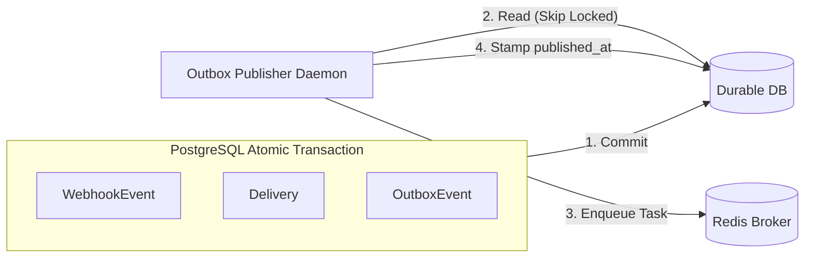

# 04 — Event Ingestion & Outbox Architecture

## 1. Ingestion Pipeline

The event ingestion API (`POST /api/v1/events/`) accepts external webhook events from upstream applications and commits them durably.

### Ingestion Flow:
1. **Authentication**: Resolves client via Bearer JWT or M2M API Key (`hk_live_...`).
2. **Workspace Scoping**: Enforces that the client possesses membership or authorized API key access for the active workspace.
3. **Payload & Topic Validation**: Ensures `event_type` and `payload` are valid non-empty structures.
4. **Idempotency Guard**:
   - Calculates the SHA-256 hash of the canonical JSON payload (`json.dumps(payload, sort_keys=True)`).
   - If `idempotency_key` is provided:
     - Check if `IdempotencyRecord` exists for this workspace.
     - If exists and hashes match: return previous response cached with **HTTP 200 OK**.
     - If exists and hashes differ: reject with **HTTP 409 Conflict** (`idempotency_conflict`).
5. **Database Transaction (`transaction.atomic`)**:
   - Insert `WebhookEvent`.
   - Query active `Endpoint` records subscribed to this event topic (exact or wildcard prefix).
   - Insert one `Delivery` record per matching endpoint with status `PENDING`.
   - Insert one `OutboxEvent` record per delivery with `published_at=NULL`.
   - Insert `IdempotencyRecord`.
6. **Post-Commit Hook**: Triggers outbox publisher asynchronously (`transaction.on_commit`).
7. **Response**: Returns **HTTP 201 Created** containing `event_id`, `matching_endpoints`, `deliveries_created`, and `delivery_ids`.

---

## 2. Fan-Out Subscription Matching

Endpoints can specify granular topic subscriptions or catch-all wildcards:
- `order.created`: Matches only exact event type `order.created`.
- `order.*`: Matches any sub-topic such as `order.created`, `order.fulfilled`, `order.cancelled`.
- `*`: Matches every ingested event in the workspace.

Matching is executed in-memory against active workspace endpoints before inserting delivery rows.

---

## 3. Transactional Outbox Pattern

### Why the Outbox Pattern is Mandatory:
In distributed systems, a two-phase commit between PostgreSQL and Redis is impractical and fragile. If an application writes to PostgreSQL and immediately sends a message to Redis, a broker failure or network hiccup leaves the event committed in the database but never dispatched to workers.

### Crash Recovery in Outbox Publishing:
If the publisher process crashes after enqueuing the Celery task but before updating `published_at`, the task will be re-published upon recovery. Because delivery workers use atomic conditional claims (`status=PENDING -> PROCESSING`), duplicate tasks in Redis are safely absorbed without duplicate HTTP dispatches.

