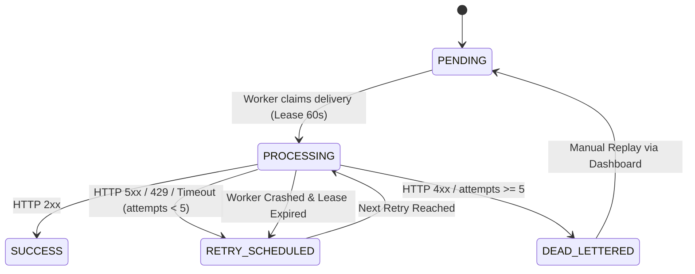

# 05 — Celery & Redis Task Architecture

## 1. Message Broker Architecture

HookSentry utilizes Redis 7 as the high-throughput message broker and Celery 5.7 as the distributed background worker harness.

### Celery Task Definitions:
1. `apps.deliveries.tasks.deliver_webhook(delivery_id)`:
   - Primary execution worker task.
   - Idempotently claims the specified delivery.
   - Signs and sends the HTTP POST request.
   - Records the delivery attempt and schedules retries if necessary.
2. `apps.deliveries.tasks.recover_stale_leases()`:
   - Heartbeat maintenance task executed every 60 seconds via Celery Beat.
   - Scans for deliveries stuck in `PROCESSING` status whose `processing_lease_expires_at` is in the past.
   - Resets status to `RETRY_SCHEDULED` and re-queues them.

---

## 2. Concurrency & Delivery Leases



### Atomic Claim Implementation:
Workers do not rely on in-memory locks. Instead, they use row-level database conditional updates:
```python
with transaction.atomic():
    delivery = Delivery.objects.select_for_update().filter(
        id=delivery_id
    ).filter(
        Q(status=Delivery.Status.PENDING) |
        Q(status=Delivery.Status.RETRY_SCHEDULED, next_retry_at__lte=now) |
        Q(status=Delivery.Status.PROCESSING, processing_lease_expires_at__lt=now)
    ).first()

    if not delivery:
        return None  # Claimed by competing worker or lease valid

    delivery.status = Delivery.Status.PROCESSING
    delivery.processing_lease_expires_at = now + timedelta(seconds=60)
    delivery.attempt_count += 1
    delivery.save()
```
If a worker crashes halfway through dispatching an external request, no lock is permanently held. After 60 seconds, `processing_lease_expires_at` lapses, allowing `recover_stale_leases` or competing workers to reclaim the delivery.
