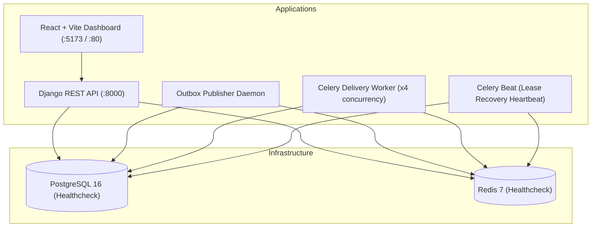

# 15 — Docker & Deployment Guide

## 1. Multi-Container Orchestration

HookSentry provides a production-structured `docker-compose.yml` orchestrating 7 interconnected services:



---

## 2. Starting the Platform

```bash
# 1. Clone the repository and configure environment variables
cp .env.example .env

# 2. Build and launch all services with Docker Compose
docker compose up --build
```

### Automatic Bootstrap on Startup:
The `api` container automatically executes:
1. `python manage.py migrate`: Applies all database migrations to PostgreSQL.
2. `python manage.py seed_data`: Seeds a default administrator user (`admin@hooksentry.dev` / `AdminPass123!`), sample endpoints, and webhook deliveries with realistic attempt history.
3. Launches the web server.

### Access Endpoints:
- **Frontend Developer Dashboard**: [http://localhost:5173](http://localhost:5173)
- **Django REST API**: [http://localhost:8000/api/v1/](http://localhost:8000/api/v1/)
- **Swagger OpenAPI Documentation**: [http://localhost:8000/api/docs/](http://localhost:8000/api/docs/)
- **Redoc Documentation**: [http://localhost:8000/api/redoc/](http://localhost:8000/api/redoc/)
